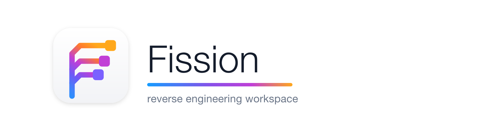

<div align="center">



**A binary analysis and decompilation CLI built for agents and scripts.**

[](https://github.com/fission-systems/Fission/actions/workflows/ci.yml)
[](https://github.com/fission-systems/Fission/releases/latest)
[](LICENSE)

[Install](#install) · [Quick start](#quick-start) · [For agents](#for-agents) · [Support](#what-it-reads) · [How it works](#how-it-works) · [Docs](#documentation)

</div>

---

Fission loads ELF, PE and Mach-O binaries, lifts machine code through Sleigh
processor specifications, and owns everything after that in Rust: its own IR,
control-flow structuring, type recovery and C output. One headless binary does
the work; there is no GUI, by design. Every command answers in text for people
and in a versioned JSON envelope for programs.

```text
$ fission_cli decomp app --name sum_to --no-header
int sum_to(int n)
{
    if (n >= 0) {
        return (uint)((n - 1) * n >> 1) + n;
    } else {
        return 0;
    }
}
```

The source was a loop (`for (i = 0; i <= n; i++) s += i;`). The compiler
replaced it with a closed form, and the output says what the binary does, not
what the source said.

Correctness is checked by running code, not by eye. `fission_cli verify`
evaluates a decompiled function, executes the same machine code in Fission's
emulator, and compares. Anything it cannot prove is reported as an assumption
rather than hidden.

## Install

**Homebrew** (macOS and Linux):

```bash
brew install fission-systems/tap/fission-cli
```

**Install script** (macOS and Linux). It installs into `~/.local` and checks the
download's SHA-256:

```bash
curl -fsSL https://raw.githubusercontent.com/fission-systems/Fission/main/install.sh | sh
```

Set `FISSION_PREFIX` to install somewhere else, or `FISSION_VERSION` to a
release tag to pin that release.

**Cargo** builds from source. Fission also needs its processor specifications
and signatures (about 100 MB), which are too large for crates.io, so they come
from the matching release:

```bash
TAG=$(curl -fsSL https://api.github.com/repos/fission-systems/Fission/releases/latest \
  | sed -n 's/.*"tag_name": *"\([^"]*\)".*/\1/p')
cargo install --locked --git https://github.com/fission-systems/Fission --tag "$TAG" fission-cli
mkdir -p ~/.cargo/share/fission
curl -fsSL "https://github.com/fission-systems/Fission/releases/download/$TAG/fission-resources.tar.gz" \
  | tar -xz -C ~/.cargo/share/fission
```

**Prebuilt archives** for Linux (x86-64, arm64), macOS (Apple silicon, Intel)
and Windows x64 are on the [releases page](https://github.com/fission-systems/Fission/releases/latest).
Unpack one anywhere and run `bin/fission_cli`. It finds `share/fission/` next to
itself, so nothing needs to be configured.

**From a clone:**

```bash
git clone https://github.com/fission-systems/Fission.git
cd Fission
cargo build -p fission-cli --release
./target/release/fission_cli --help
```

`fission_cli resources status` shows where the binary found its resources.

## Quick start

```bash
fission_cli info    app                     # format, architecture, compiler, provenance
fission_cli list    app                     # discovered functions
fission_cli decomp  app --addr 0x401130     # one function as C
fission_cli decomp  app --all               # every function
fission_cli disasm  app --addr 0x401130     # instructions
fission_cli xrefs   app --to 0x404010       # who references an address
fission_cli strings app --min-len 6
```

Beyond decompilation, the same binary covers:

| | |
|---|---|
| `callgraph`, `xrefs` | Call and reference graphs |
| `hex`, `search`, `patch` | Read bytes, find patterns, write a patched copy |
| `identify`, `similar` | Library-function recognition (Ghidra FID databases) and structural similarity |
| `db` | Names, notes and breakpoints kept beside the binary, with undo and diff |
| `script` | Rhai scripts over a read-only view of the binary |
| `debug`, `sandbox` | Emulation, and native debugging on Linux and macOS (Windows behind a build feature) |
| `verify` | Emulator- and solver-backed checking of decompiled output |
| `raw-pcode`, `pcode-stages`, `nir-stats` | The IR at each stage, for debugging the decompiler itself |

The full reference is [`docs/CLI.md`](docs/CLI.md).

## For agents

Fission is meant to be driven by programs, including language-model agents.

- `--contract v1` turns any command into one JSON envelope on stdout with typed
  exit codes (0 ok, 1 failed, 2 usage, 3 input, 4 partial, 5 timeout,
  6 environment, 70 internal).
- `fission_cli schema` prints the envelope's JSON Schema; `--error-codes` lists
  the stable error codes.
- `fission_cli skill` prints the agent usage guide that is compiled into the
  binary, so an agent can learn the tool from the tool.

```bash
fission_cli --contract v1 decomp app --addr 0x401130
```

## What it reads

Measured on one test program compiled for each target
([method and numbers](docs/roadmap/1.0-criteria.md#support-matrix-measured-2026-11-13)):

| | Tested | Best effort |
|---|---|---|
| **ELF** | x86-64, x86-32, ARM32/Thumb | AArch64, MIPS, PowerPC 32/64, RISC-V |
| **PE** | x64, x86 | ARM64 |
| **Mach-O** | | x86-64, arm64 |
| **Other** | | NE, a.out, Intel HEX, Motorola HEX, raw firmware with `--language` |

"Best effort" means the cell loads, lists and decompiles in that measurement but
is not yet held to the same bar. Any processor Ghidra's Sleigh specifications
describe can be lifted; `--language` picks one for raw images that have no
header to detect it from.

## How it works

```text
binary ─▶ fission-loader     format, sections, symbols, imports
       ─▶ fission-static     facts: discovery, xrefs, jump tables
       ─▶ fission-sleigh     decode and lift to p-code (Rust Sleigh runtime)
       ─▶ fission-pcode      SSA, normalization, type recovery, structuring
       ─▶ C output           one tree, rendered once
```

Fission reads Ghidra's Sleigh specifications but does not run Ghidra; the Sleigh
runtime and everything downstream of it are Fission's own Rust code. Structuring
runs three published approaches against one shrinking control-flow graph and
picks one result per function: Ghidra-style collapse rules, angr Phoenix
schema matching, and DREAM reaching conditions. The crate-by-crate map is in
[`docs/PROJECT_MAP.md`](docs/PROJECT_MAP.md) and the design record in
[`docs/adr/`](docs/adr/).

## Evaluation

Quality is measured on [DecBench](https://decbench.com), which scores control-flow
structure against the source (graph edit distance), recovered types against DWARF,
and whether the output recompiles. A score that looks only at CFG shape and types
cannot tell whether the emitted C does what the binary does, so semantic defects
are hunted separately with execution: `verify`, and differential runs against the
emulator. Numbers for each release and how they were reached are in
[`docs/changelog/`](docs/changelog/) and [`docs/EVALUATION.md`](docs/EVALUATION.md).

## Documentation

| | |
|---|---|
| [`docs/CLI.md`](docs/CLI.md) | Command reference |
| [`docs/PROJECT_MAP.md`](docs/PROJECT_MAP.md) | Crates and what each owns |
| [`docs/architecture/`](docs/architecture/) | Pipeline, dynamic analysis, Ghidra parity audit |
| [`docs/adr/`](docs/adr/) | Architecture decision records |
| [`docs/changelog/`](docs/changelog/) | Release notes |
| [`docs/roadmap/1.0-criteria.md`](docs/roadmap/1.0-criteria.md) | What 1.0 will promise, and what is still open |
| [`AGENTS.md`](AGENTS.md) | Working rules for changing the decompiler; read before contributing |
| [`CONTRIBUTING.md`](CONTRIBUTING.md) | How to contribute |

## Development

```bash
cargo build -p fission-cli --release   # the CLI
cargo nextest run --workspace          # all tests
cargo fmt --all --check                # CI's formatting check
```

A change to decompiler output is judged by measurement on real binaries, not by a
passing synthetic test; [`AGENTS.md`](AGENTS.md#decompiler-quality-loop) explains
the loop.

## Security

Fission is built to read untrusted binaries. Handling rules for samples are in
[`docs/MALWARE_SAMPLE_POLICY.md`](docs/MALWARE_SAMPLE_POLICY.md). Report
vulnerabilities through GitHub Security Advisories, not a public issue.

## License

Apache-2.0. See [`LICENSE`](LICENSE) and, for third-party attributions,
[`NOTICE`](NOTICE).
